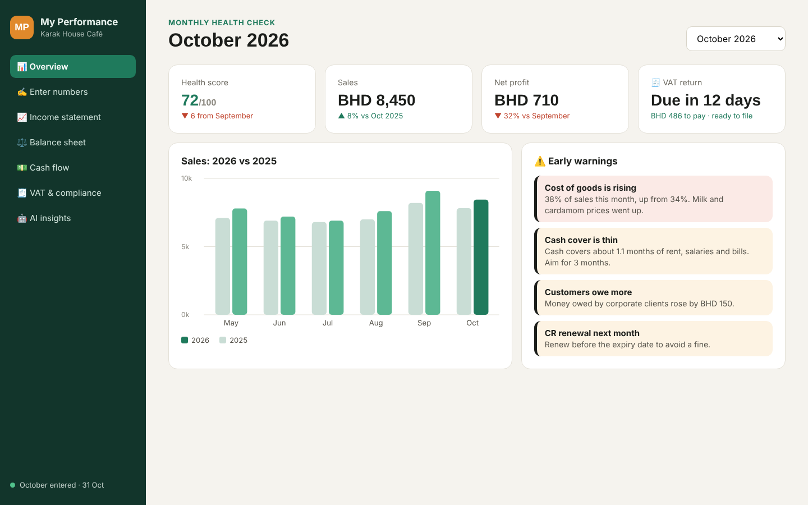
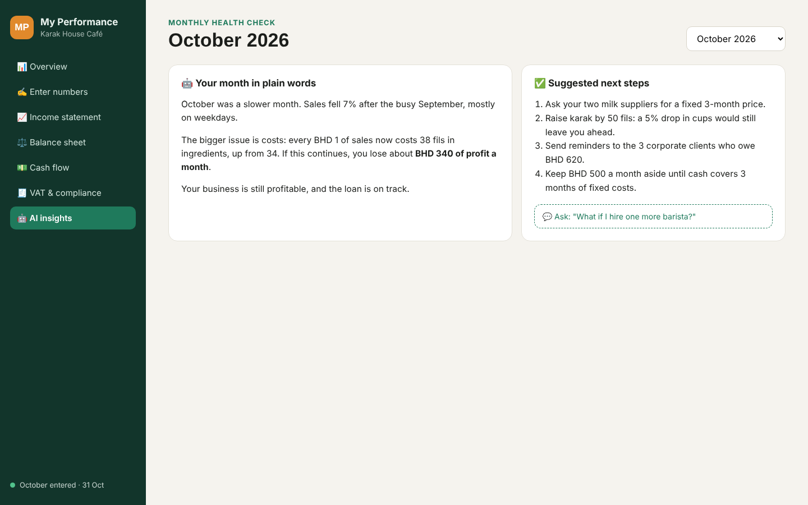
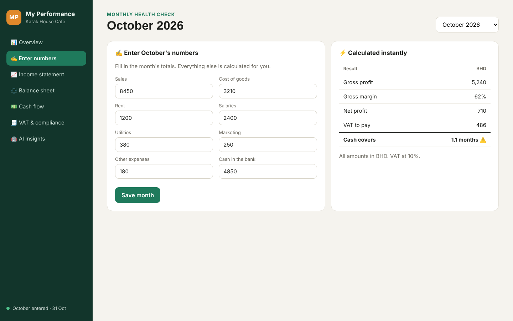
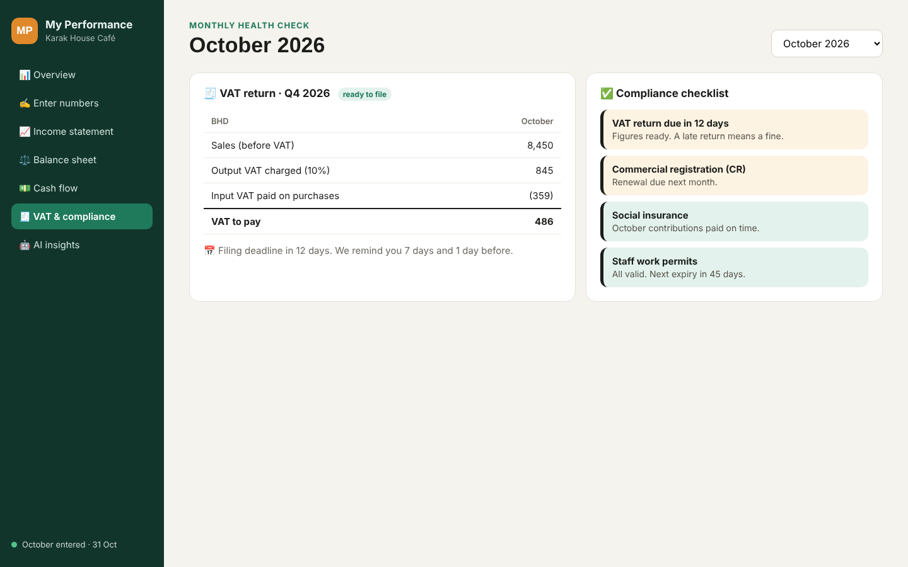

# My Performance

**A monthly health check for small businesses in Bahrain.**

Small business owners often find out something is wrong only when the cash runs out, and VAT or licence deadlines can cost them fines. Owners enter their monthly numbers and My Performance builds the statements, handles VAT and compliance, and warns early.

**Live mockup:** https://mohammedbaqerdata.github.io/my-performance/

## What it does

- 📊 **Monthly dashboard** – health score, sales, profit and cash at a glance
- 📑 **Three statements, built automatically** – income statement, balance sheet and cash flow
- ✍️ **Simple monthly entry** – the owner fills in sales and expenses; everything else is calculated
- 🧾 **VAT and compliance** – VAT worked out, deadlines tracked, reminders before fines
- 📈 **Compare with the past** – every month against previous months and years
- 🤖 **AI insights** – explains the month in plain words, flags early warnings and suggests next steps
- ⚠️ **Early warnings** – rising costs, thin cash cover, customers paying late

## The bigger picture

With owners' consent, anonymous monthly figures from many small businesses could give a government partner such as Tamkeen an up-to-date view of how SMEs in Bahrain are performing, by sector and area, with early warning signs before businesses fail.

## Status

Concept and clickable mockup. The numbers shown are for a sample café.

| Enter numbers | VAT and compliance |
|---|---|
|  |  |

---
Mohammed Baqer · Financial Technology, Bahrain Polytechnic · [LinkedIn](https://linkedin.com/in/mohamed-baqer)
