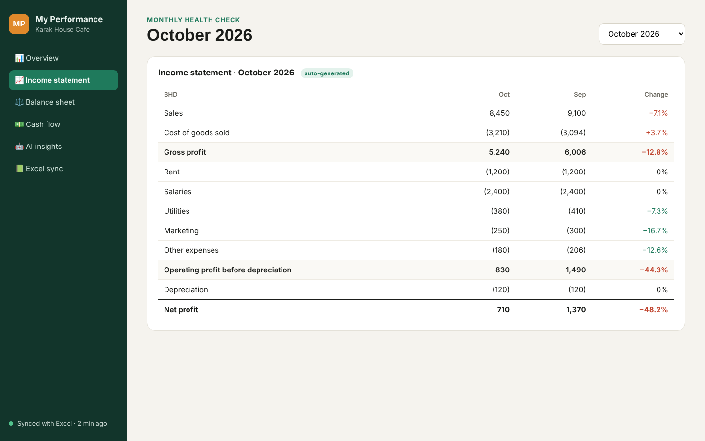
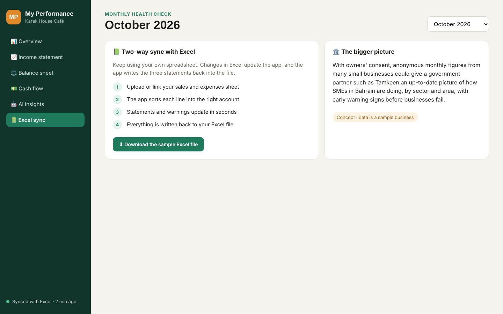

# My Performance

**A monthly health check for small businesses in Bahrain.**

Small business owners often find out something is wrong only when the cash runs out. My Performance turns the sales and expenses they already keep in Excel into a clear monthly picture, so problems are caught early.

**Live mockup:** https://mohammedbaqerdata.github.io/my-performance/

## What it does

- 📊 **Monthly dashboard** – health score, sales, profit and cash at a glance
- 📑 **Three statements, built automatically** – income statement, balance sheet and cash flow
- 📗 **Two-way Excel sync** – keep working in your own spreadsheet; the app reads it and writes the statements back
- 🤖 **AI insights** – explains the month in plain words, flags early warnings and suggests next steps
- ⚠️ **Early warnings** – rising costs, thin cash cover, customers paying late

## The bigger picture

With owners' consent, anonymous monthly figures from many small businesses could give a government partner such as Tamkeen an up-to-date view of how SMEs in Bahrain are performing, by sector and area, with early warning signs before businesses fail.

## Status

Concept and clickable mockup. The numbers shown are for a sample café. A sample Excel file is in [`assets/My_Performance_Sample.xlsx`](assets/My_Performance_Sample.xlsx).

| Income statement | Excel sync |
|---|---|
|  |  |

---
Mohammed Baqer · Financial Technology, Bahrain Polytechnic · [LinkedIn](https://linkedin.com/in/mohamed-baqer)
